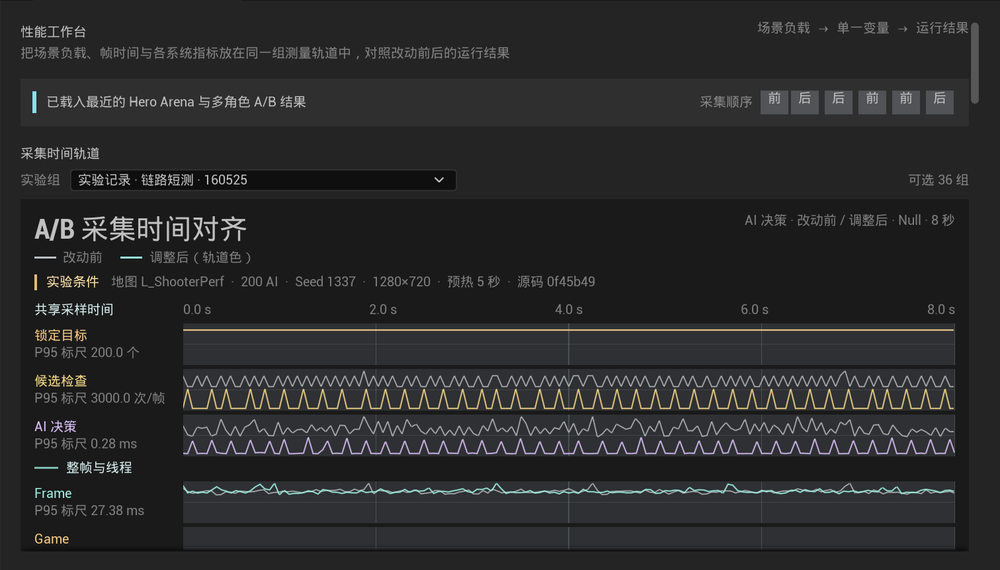
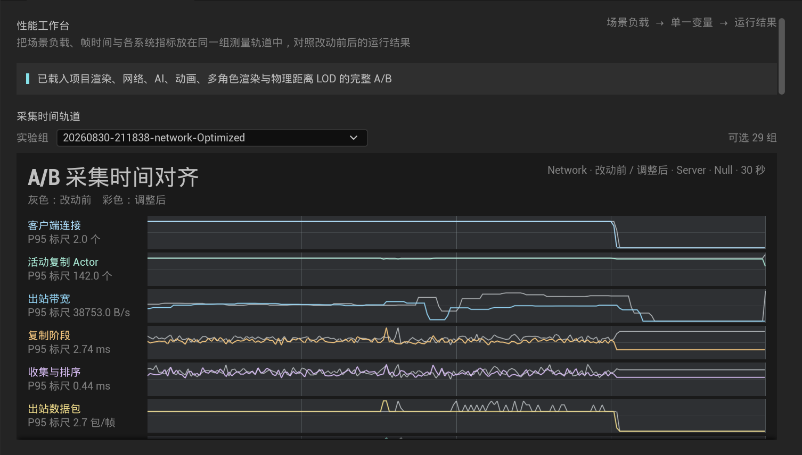
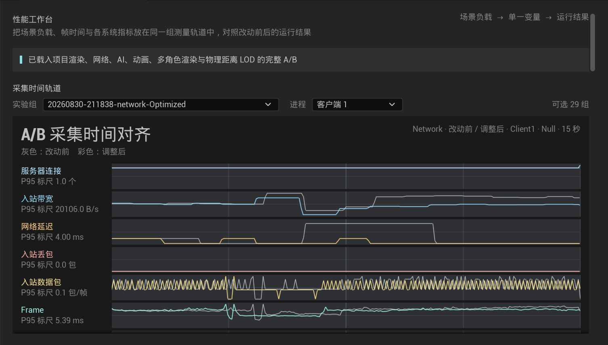
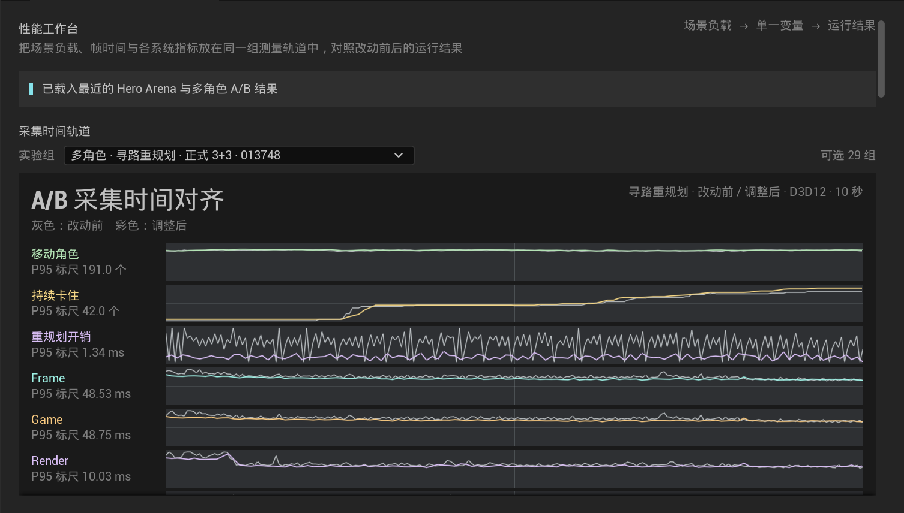
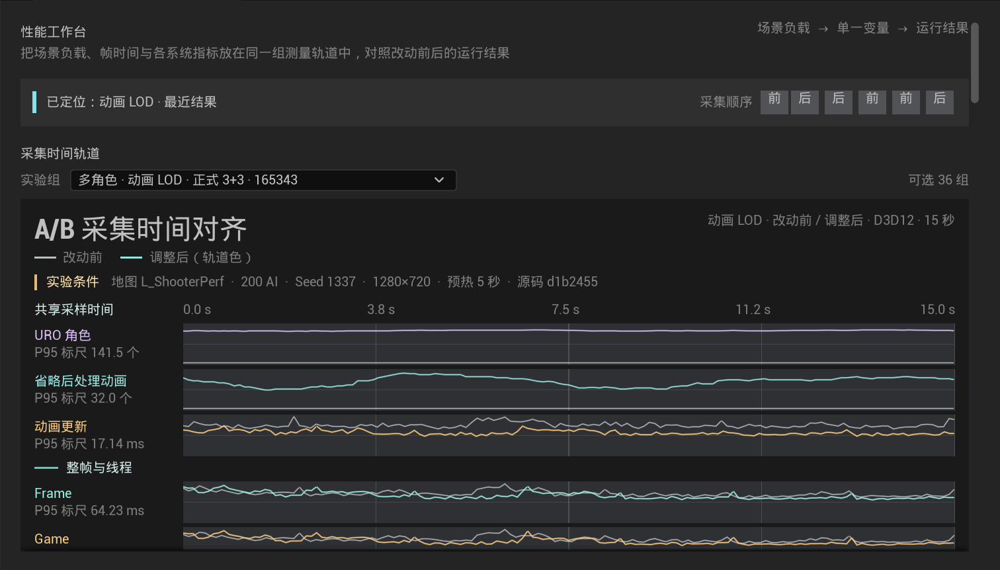
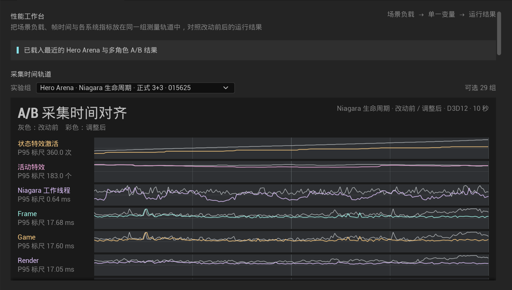
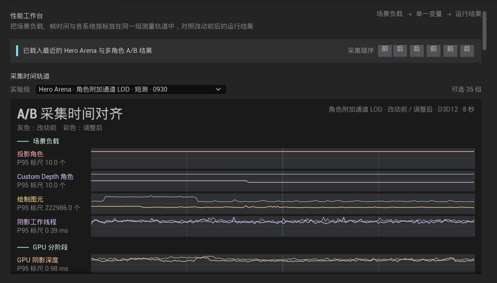

# 性能工作台

性能工作台是在 Unreal Editor 内运行、诊断和比较 UE/Lyra 性能的中文工具。它既能驱动多角色高负载实验，也能分析 HeroArena、TDM、Control Point 等真实 Lyra 地图和多人会话。

打开方式：编辑器菜单“工具 → 性能工作台”。

采集控制台按负载来源分成三组：Hero Arena 实战、受控子系统负载和 200 角色压力场。固定武器事件、Niagara 生命周期和 300 个 Chaos 刚体归入受控负载，不与真实 5v5 的开火、拾取点和多人网络数据混写。

当前提供：

- 通用 `ExperimentPreset`、`Session`、`Artifact`、`Comparison` 和条件检查数据结构。
- 独立启动服务从预设生成运行参数；界面不直接拼接多角色实验命令行。
- AI 决策与状态机、寻路、IK 与动画 LOD、渲染四个独立方向。
- 用独立进程启动固定地图、200 个 Lyra Pawn、固定种子和固定时长的基线。
- 显示最近八次运行是否有效、实际 AI 数量和平均帧时；每条记录可直接定位到对应实验、Session 和进程时间轨道。
- 从有效运行的 `capture.csv` 绘制场景负载、Frame、Game、Render、GPU 时间轨道；共享秒刻度与每条轨道的竖向网格对齐，改动前使用灰线，调整后沿用该指标的轨道色。角色附加通道轨道同时显示 Custom Depth 角色数、Shadow Depth、TSR、Lumen 反射、Nanite 可见性与 Custom Depth GPU 时间。
- 实验组选择器优先列出近期有效 Session，并额外保留每个测量维度最新三组；单次 Run 仍保留在结果目录中，不占用主界面的选择层级。
- 采集控制台在每条轨道下直接显示现有结果是正式同批次 3+3、同条件 A/B、短测还是尚无有效采集，并列出两侧样本数。
- 正式 3+3 对比同时显示每项指标的中位数与三次样本最小—最大范围；改动前后范围重叠时在结果判断中直接标出。
- “保存对比报告”把当前批次的实验条件、场景状态、精确引擎版本、样本范围与指标表写入 `Saved/PerformanceLab/Reports`，不修改原始采集文件；旧样本未记录引擎版本时会明确标注。
- Network Session 默认以 Dedicated Server 为主轨道，显示连接数、活动复制 Actor、出站带宽、出站包、Gather/Prioritize 与 ServerReplicateActor 时间；客户端采集仍保留在同一 Session 目录体系中。
- Network Baseline/Optimized 可以分属不同 Session；只有预设、源码版本、地图、随机种子、负载、预热与测量时长、进程角色、NetMode 和连接条件一致时才会叠加。
- 多进程 Session 可切换服务器、客户端 1 与客户端 2。客户端轨道显示入站带宽、Ping、丢包、入站包和本机帧时间；只有客户端使用正常 RHI 时才补 Render/GPU。
- 一键打开原始结果目录。

AI 与寻路实验由工作台使用 NullRHI 启动，用于隔离逻辑侧 CPU 开销；动画、渲染、物理和 Niagara 实验保留正常 RHI。时间轨道会把累计计数转换为每帧增量，与正式汇总保持同一统计口径。

正式产品范围：

- 渲染：CPU/GPU/Render/RHI 帧时、Draw Call、Primitive、阴影、主要 GPU Pass、显存与固定镜头质量对比。
- 网络：服务器/客户端带宽、包率、Actor/RPC/属性复制、Dormancy、NetUpdateFrequency 和 Replication Graph。
- 系统：AI、寻路、动画/IK、内存、Niagara，以及带固定刚体数和活动数记录的 Chaos 物理负载。
- 工作流：任意地图/Experience 预设、多人进程编排、Trace/CSV、阶段标记、有效性检查、成对 A/B 和回归提示。

每条轨道只有在拥有实际调整变量后才开放“运行调整后版本”。Hero Arena 角色附加通道轨道比较原始 Custom Depth 提交与 2400 uu 距离 LOD；本地玩家、近场角色和独立的伤害数字组件不被省略。两组短 A/B 都减少了保留 Custom Depth 的角色数，GPU 阶段方向不一致，当前不把它列为已确认的整帧收益。原 5v5 角色阴影方案保留为历史结果，不再作为该轨道的调整变量。

工作台复用 `PerformanceLab`、Lyra 性能统计、Unreal Insights/Network Insights 和引擎 `AutomatedPerfTesting`/CSV 能力，不维护第二套 Profiler。具体优化落在真实 Lyra C++、Replication Graph、Game Feature、动画、渲染和 Niagara 系统中。
