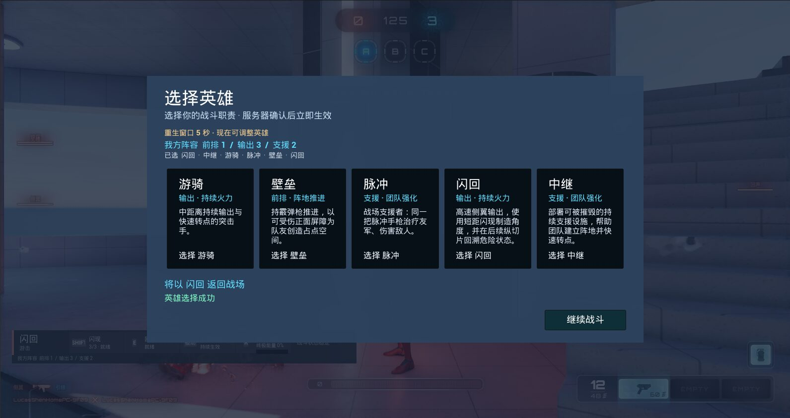
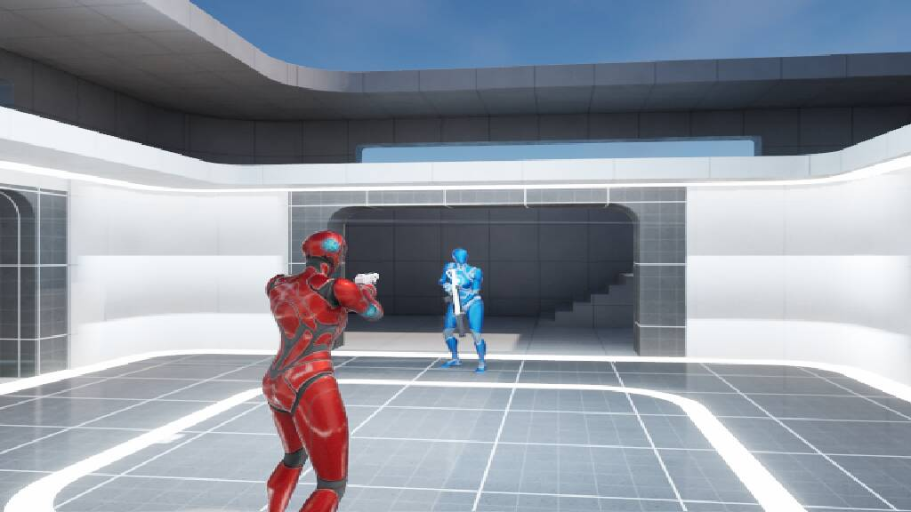
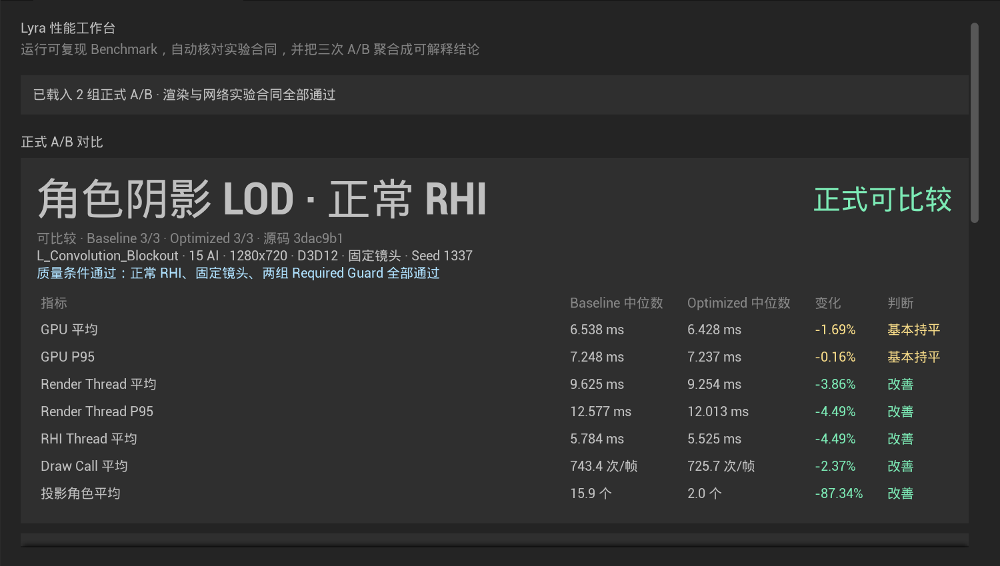
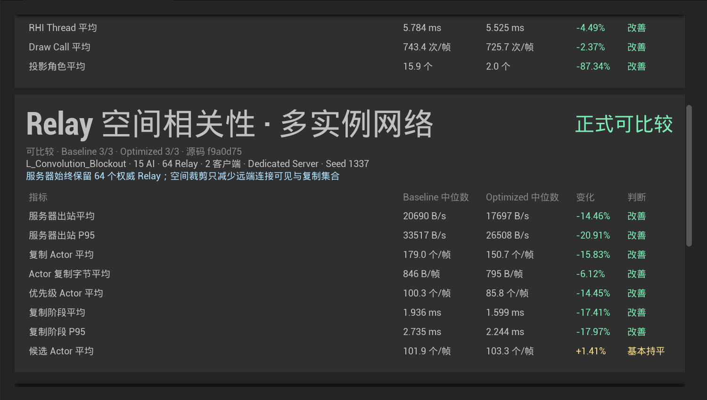

# Lyra Hero Arena

基于 **Unreal Engine 5.7.4 / Lyra Starter Game 5.7** 开发的多人英雄射击与性能工程项目。工程在一套可运行的 5v5 对局中完成玩法扩展，并将多角色优化与性能采集整理为两个可独立介绍的方向。

> 公开仓库只包含自研 C++、技术说明和实机截图，不分发 Lyra、Fab 或 Unreal Engine 资产。

<table>
  <tr>
    <td width="50%"></td>
    <td width="50%"></td>
  </tr>
</table>

## 项目内容

### Lyra Hero Arena｜五英雄多人对战游戏

在 Lyra 的武器、队伍、GAS、PawnData、CommonUI 和联网框架上扩展五名英雄与 5v5 比赛流程。

- Striker、Bulwark、Pulse、Phase、Relay 分别覆盖输出、前排、支援、侧翼和战术控制；英雄由 Ability Set、装备和数据定义组合。
- 服务器负责选人校验、能力装配、终极能量、死亡、重生、换人和结算，客户端提交操作意图并接收复制结果。
- 已完成轮换控制点、战场脉冲和团队淘汰三种规则；一名玩家与九名职责机器人可组成完整 5v5 对局。
- 机器人沿用 Lyra 的控制点行为树，并根据英雄职责选择治疗、位移、屏障、部署物和终极技能的使用时机。
- 选人界面、队友职责与生命标记、战术 HUD、计分板和赛后流程已接入实际对局。

自有玩法集中在 `HeroArena` Game Feature。C++ 处理权威规则、生命周期和网络边界，Blueprint 与 Data Asset 负责装配与表现。

### 多角色高负载场景性能优化

性能实验以 200 个 Lyra Pawn、固定 Chaos/Niagara 负载以及真实服务器与多客户端会话构造压力场景。AI、寻路、动画/IK、渲染、物理、特效和网络分别保留 Baseline / Optimized，并同时记录角色行为、画质和连接状态。

当前具有稳定对比的代表结果：

| 方向 | 调整 | 当前 3+3 结果 |
| --- | --- | --- |
| AI 目标发现 | 逐角色扫描改为共享战场事实 | 决策平均中位数 `0.1392 → 0.0240 ms/帧`；Frame P95 约下降 `9.1%` |
| Animation / IK | 远景更新降频，并在 2400 uu 外省略 FootPlant Post Process | Animation 平均中位数 `15.18 → 10.99 ms`；Frame P95 约下降 `10.3%` |
| Navigation | 合并相同目标并限制重复重规划 | 路径请求约下降 `82%`；Frame 均值与 P95 约下降 `1.7%` |
| 角色光追 | 1500 uu 外角色退出 Ray Tracing Scene | 动态光追几何平均中位数 `4.02 → 2.50 ms`；GPU 总平均基本持平 |
| 网络相关性 | Relay 部署物按连接相关性复制 | 服务器出站带宽约 `20.7 → 17.7 KB/s`；复制阶段约 `1.94 → 1.60 ms` |

物理距离 LOD、角色阴影和部分动态 Niagara 方案保留了测试记录，但没有作为默认游戏改动：它们在现有场景中没有形成稳定的整帧收益，或会改变画面与负载条件。

### UE Performance Workbench｜性能实验工作台

`PerformanceWorkbench` 是运行在 Unreal Editor 内的中文实验工具；`PerformanceLab` 是不依赖 Editor 的运行时采集模块。两者通过版本化 Preset 和 JSON/CSV 结果连接。

- 14 条实验轨道覆盖真实 5v5、受控子系统负载和 200 角色压力场。
- 可启动单机、Dedicated Server 与多个 Client，统一运行编号、预热、采样和输出目录。
- 连续执行 Baseline / Optimized 各三次，展示中位数、P95、变化率和样本范围。
- 时间轨道列出 CPU、工作线程、Render Thread 与 GPU Pass 的主要开销；Niagara 可继续下钻到具体 System 与 Owner。
- 每条轨道同时显示人数、行为、画质、RHI 或网络拓扑，避免比较不同负载下的两组数据。
- 原始 CSV、运行参数和未采用的结果均保留，便于复查归因。

<table>
  <tr>
    <td width="50%"></td>
    <td width="50%"></td>
  </tr>
</table>

## 工程结构

```text
Plugins/
├── GameFeatures/HeroArena/   # 英雄、能力、模式与比赛流程
├── PerformanceLab/           # 运行时压力场、采集与场景状态
└── PerformanceWorkbench/     # Editor 内实验编排与结果比较
docs/
└── 技术报告.md
```

## 当前状态

- 五英雄 5v5 对局、三种比赛规则、机器人职责行为和完整比赛生命周期已经连通。
- 性能实验覆盖七个方向，工作台可读取并比较 14 条轨道；本仓库中的数字来自固定条件下的阶段采样，不作为其他项目的通用性能承诺。
- 下一阶段以实际对局的可读性、机器人技能决策和发布演示收口为主，不继续横向增加英雄、模式或无明确热点的性能案例。

开发环境为 Windows 11、Unreal Engine 5.7.4（CL 51494982）和 Lyra Starter Game 5.7。公开源码快照不能独立运行；地图、角色、动画、武器、音频和 UI 需由具备许可的 Epic/Fab 账户取得并完成工程装配。

架构、实验条件与结果边界见 [技术报告](docs/技术报告.md)。

## 来源与许可

Lyra 原有的射击、队伍、GAS、装备、基础机器人、地图和资产不计入自研内容。`HeroArena`、`PerformanceLab` 与 `PerformanceWorkbench` 为本项目新增模块；对 Lyra 源码的少量接入在技术报告中说明。

Unreal Engine、Lyra Starter Game 及 Epic 内容遵循 Epic Games 的许可条款。本仓库不授予第三方内容的再分发权。
