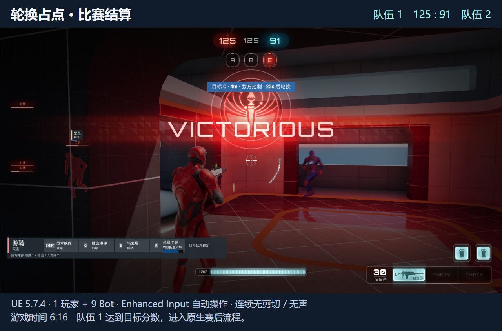

# 轮换占点：完整比赛与结算

[连续实机视频](https://ubik42.github.io/?work=lyra-hero-arena)

本次单机对局从 **0:0** 完整运行至 **125:91**，队伍 1 达到目标分 125 并进入 `PostGame`。重采样后的连续实机视频约 **379.7 秒**（约 6 分 20 秒），完整经历 A/B/C 三点轮换、交火与重生流程。在游戏时间 375.277 秒确认胜负后，赛后状态继续采样 5.234 秒，比分稳定保持 125:91。

项目基于 UE 5.7.4 / Lyra 搭建，展示 Striker 玩家阵亡后自动重生并重返活动控制点参与交火的完整循环。

## 轮换与计分规则分工

对局结算复用 **ShooterCore 原生占点计分与终局逻辑**，自有轮换组件负责驱动 A/B/C 点状态流转，并通过清空停用点的占有者缓存使其退出计分，同时扩展战术 HUD 与非侵入式只读诊断接口。

- **Lyra 原生规则：** 由 `B_ControlPointScoring` 每秒比对双方占点数量，领先方的 `ShooterGame.ControlPoint.TeamScore` 加一。当比分达到 `TargetScore` 时调用 `HandleVictory` 写入 `WinningTeamId`，触发 `Phase_PostGame` 并终止计分计时器。基础移动、武器、动画、死亡判定与自动重生均沿用 Lyra 原生实现。
- **HeroArena 扩展：** 轮换组件统一管理活动点、下一点、当前占有者、占领进度及轮换倒计时；控制点停用时同步清除占领缓存，确保轮出点停止贡献分数。英雄技能体系与战术 HUD 在此流程中持续运行。
- **只读状态诊断：** 提供开发命令 `HeroArena.Debug.LogMatchFrame`，直接读取队伍比分、目标分、获胜方与比赛阶段，不篡改任何玩法数据。该查询不依赖 Pawn，在角色阵亡等待与赛后阶段仍可稳定采样，且不编入 Shipping 构建。

## 录制说明

对局在单机 PIE 环境下运行（1 名玩家 + 9 名 Bot）。外部脚本仅读取导航路径与视线可见敌人坐标，通过 Enhanced Input 接口派发移动、瞄准、射击、换弹及技能输入，无 God 模式、无坐标传送、无直接伤害注入，亦无脚本强行占点或篡改分数。

原始帧按游戏时间戳连续回放，保留完整的转点等待与阵亡重生过程，无剪辑，无音频。本测试用于验证单机单局完整性与结算闭环，不代表多端网络同步测试或性能基准测试。

## 运行入口

在 Lyra 5.7 宿主工程中引入本插件覆盖层及依赖资产，指定 `B_HeroArena_ControlPoints` Experience 与 `/ShooterMaps/Maps/L_Convolution_Blockout` 地图。玩家通过常规操作选人、交火与占点，比赛达到预设目标分后自动结算，无需任何调试指令干预。

Development 构建提供以下诊断命令：

- `HeroArena.Debug.LogGameplayFrame`：采样当前 Pawn 的导航、位置与生命值等状态。
- `HeroArena.Debug.LogMatchFrame`：采样全局比分、目标分、结算状态与比赛阶段（支持 Pawn 不存在阶段）。

公开仓库包含自有代码、配置、技术说明和实机截图，不包含 Lyra 宿主工程、美术资产及本地录制桥。

## 源码索引

[本次比分与阶段记录](data/full-match.json) 对应提交 `67048b00045f183294844c690fedbd7c31512ace`（Development 构建通过）。记录来自单机连续对局，录像外围比分信息由该只读采样在后期按时间戳匹配生成。

- [控制点轮换与计分缓存](../Plugins/GameFeatures/HeroArena/Source/HeroArenaRuntime/Private/Components/HeroArenaControlPointRotationComponent.cpp)
- [GAS 恢复场技能](../Plugins/GameFeatures/HeroArena/Source/HeroArenaRuntime/Private/Abilities/HeroArenaGameplayAbility_RecoveryField.cpp)
- [战术 HUD 控件](../Plugins/GameFeatures/HeroArena/Source/HeroArenaRuntime/Private/UI/HeroArenaCombatHUDWidget.cpp)
- [只读比赛与角色状态查询](../Plugins/GameFeatures/HeroArena/Source/HeroArenaRuntime/Private/HeroArenaRuntimeModule.cpp)
