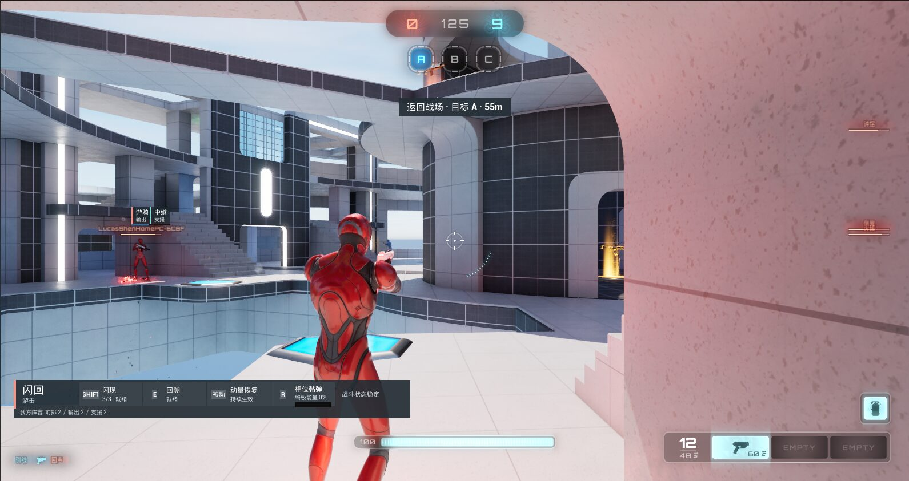

# 接入与验证

## 快照范围

本仓库提供 HeroArena、PerformanceLab、PerformanceWorkbench 三个插件的 199 个源码及描述文件。2026-10-17 对齐完整开发工程提交 `f424df9e94bc8f1c2eabd209d39b273774a07058`，版本为 UE 5.7.4 / CL 51494982、Lyra Starter Game 5.7。各文件的内容指纹见 [源码清单](data/source-manifest.json)，按 UTF-8/LF 归一化计算。

运行完整示例还需要以下内容：

| 内容 | 当前提供方式 |
| --- | --- |
| 三个自研插件的 C++ 与模块依赖 | `Plugins/` 源码 |
| HeroArena GameFeatureData、Experience、Roster、英雄定义、能力和输入资产 | [48 项项目资产路径清单](data/required-project-assets.json)；资产本体未分发 |
| Gameplay Tag 扩展 | [65 条新增 Tag 配置](integration/HeroArenaGameplayTags.ini)；需接入宿主的 Tag 配置加载 |
| Lyra 宿主 API 与性能接入 | 下表列出实际改动；宿主源码未包含在本快照中 |
| 地图、角色、动画、武器、特效与音频 | 使用具备许可的 Epic/Fab 内容 |

完整开发工程已编译和实机运行。公开快照用于源码审阅，尚未提供从干净 Lyra 自动装配到可运行游戏的安装包。

## Lyra 宿主接入清单

下表来自开发工程相对干净 Lyra 5.7.4 基线的源码差异。路径均相对于宿主 `Source/LyraGame/`。

| 文件或模块 | 实际接入点 | 对应调用方 |
| --- | --- | --- |
| `AbilitySystem/LyraAbilitySet.h` | 导出 `ULyraAbilitySet` 与 `FLyraAbilitySet_GrantedHandles` | HeroArena 跨模块授予与撤销能力 |
| `Equipment/LyraQuickBarComponent.h` | 导出活动槽位、查询、添加和移除接口 | 英雄换人时替换主武器 |
| `Input/LyraInputConfig.h` | 导出输入配置类型 | 英雄能力输入配置 |
| `GameModes/LyraBotCreationComponent.h`、`Player/LyraPlayerBotController.h` | 导出 Bot 创建组件与控制器 | 职责 Bot 与压力场创建 |
| `Inventory/InventoryFragment_SetStats.h`、`Inventory/LyraInventoryItemInstance.h` | 导出物品片段与实例类型 | 装备数值与物品操作 |
| `Weapons/LyraRangedWeaponInstance.*` | 按来源 Tag 设置/撤销临时散布倍率 | 英雄武器强化，保留武器原始曲线 |
| `Character/LyraCharacter.*`、`System/LyraSignificanceManager.*` | 动画更新、骨骼 LOD、后处理动画、CustomDepth、光追与距离策略；提供观测接口 | PerformanceLab 采集实际生效数量 |
| `Cosmetics/LyraPawnComponent_CharacterParts.cpp`、`Equipment/LyraEquipmentInstance.cpp` | 注册与移除角色附属网格/装备 | 距离策略覆盖角色部件，恢复默认值 |
| `System/LyraSystemStatics.*`、`Weapons/LyraWeaponSpawner.*` | 武器表现、拾取点更新与常驻特效策略 | 特效与真实对局实验 |
| `UI/LyraGameViewportClient.*`、`Settings/LyraSettingsLocal.cpp` | 性能采集时的后台/离屏运行支持 | 固定条件的采样进程 |

`PerformanceLab` 直接读取扩展后的 `ALyraCharacter` 接口。只复制插件、缺少宿主接入时，会遇到符号导出或成员缺失错误。上述接口是当前工程依赖，不代表 Epic Lyra 原版 API。

## 完整工程的运行入口

以下命令适用于已完成上述宿主与资产装配的工程。变量由使用者填写，公开快照本身不包含 `.uproject`。

```powershell
& "$EngineRoot\Engine\Build\BatchFiles\Build.bat" LyraEditor Win64 Development "-Project=$ProjectFile" -WaitMutex -NoHotReloadFromIDE
& "$EngineRoot\Engine\Binaries\Win64\UnrealEditor.exe" $ProjectFile /ShooterMaps/Maps/L_Convolution_Blockout -Experience=B_HeroArena_ControlPoints
```

游戏模式通过 Experience 激活 HeroArena。插件描述中的 `ExplicitlyLoaded=true`、`EnabledByDefault=false` 保持原有 Game Feature 加载方式。

## Blink 预测拒绝与弱网检查

开发构建提供三个命令，Shipping 构建不包含这些故障注入入口：

| 命令 | 作用 |
| --- | --- |
| `HeroArena.Debug.LogBlinkNetwork <stage>` | 输出人类玩家的 PlayerId、位置、可见充能与待确认请求数，以及当前 NetDriver 模拟配置 |
| `HeroArena.Debug.SetBlinkBlocked <controller-index> <0或1>` | 仅在服务器 ASC 阻止/恢复 Blink 激活，用于制造客户端预测与服务器判断不一致 |
| `HeroArena.Debug.SetNetworkSimulation <lag-ms> <loss-percent>` | 对当前世界 NetDriver 设置出站延迟和丢包；`0 0` 恢复。仅在启用引擎网络测试代码时生效 |

双 PIE 使用 Listen Server 与一个拥有客户端。分开两名玩家的起点，确认拥有客户端为 Phase。分别在两个世界执行 `HeroArena.Debug.SetNetworkSimulation 150 2`，在服务器阻止远端玩家 Blink，再通过客户端原有 Enhanced Input 触发技能。先检查客户端真实发生预测扣减，再检查拒绝后恢复；解除阻止后继续验证正常释放、连续耗尽、充能和换人重置。

2026-10-17 的有效弱网记录以拥有客户端 `PlayerId=259` 对齐。早期客户端为 2 格、pending=1；拒绝后两端 3 格，正常释放后 2 格，连续两次后 0 格，恢复一格后 1 格，换人重置后 3 格，稳定检查点 pending=0。首次弱网布置因角色起点重叠导致碰撞拒绝，未覆盖消耗路径，已排除；随后分开起点重跑，并加入具体次数断言。完整状态见 [Blink 双端数据](data/blink-network.json)。

14 秒视频独立采集，展示一次拒绝、一次成功释放和恢复满充能。两个 Slate 视角顺序采样约 8 帧/秒，按独立时间戳组合，未宣称逐帧同步。模拟器设置不等同于实测 RTT，也不能保证短视频中恰好丢失某个比例的数据包。

## GAS 换人与重生检查

开发构建的只读命令 `HeroArena.Debug.LogGAS` 输出 PlayerId、英雄选择、Pawn、ASC Avatar 和以 HeroDefinition 为来源的 AbilitySpec。它不改选择、不授予能力，也不修改复制规则。

2026-10-17 实测采用正常 D3D12、同进程双 PIE：监听服务器与拥有客户端。测试顺序为 Striker → 死亡窗口请求 Phase → Phase 重生。死亡与换人由开发命令触发，选择仍经现有 Server RPC 校验。

| 状态 | 服务器 | 拥有客户端 |
| --- | --- | --- |
| Striker | 7 项英雄来源 AbilitySpec | 7 项英雄来源 AbilitySpec |
| 切换 Phase | 4 项，旧 Striker 来源无残留 | 4 项，旧 Striker 来源无残留 |
| Phase 重生 | ASC Avatar 与新 Pawn 一致，4 项不重复 | ASC Avatar 与新 Pawn 一致，4 项不重复 |

Striker 的 7 项包含工程期选人及 Bot 支持能力。Phase 的 4 项为 Blink、PhasePistolTuning、Recall、StickyBomb。非拥有者可见英雄选择，AbilitySpec 列表按拥有者复制。结果见 [双端记录](data/gas-network.json)。本轮没有验证弱网、跨进程或完整比赛。



## 性能摘要如何复查

[性能记录](data/performance-results.json) 包含动画和 HUD 两组各 3+3 次运行的指标、条件以及原始 CSV/summary 指纹。采集日期为 2026-08-31，复算日期为 2026-10-17。计算方式是“三次运行各自统计量的中位数”；P95 也按各次 P95 求中位数，不是合并全部帧后的 P95。

- 动画：200 AI，预热 5 秒、采样 15 秒、1280×720、D3D12、i7-13700F / RTX 4080。平均动画耗时 15.180 → 10.989 ms；整帧 P95 65.170 → 58.480 ms。
- HUD：1 玩家 + 9 Bot，预热 8 秒、采样 10 秒。局部刷新 0.0620 → 0.0057 ms，总 UI 1.666 → 1.554 ms；整帧 P95 11.268 → 11.242 ms，基本不变。

JSON 提供摘要级复算；完整 CSV 保存在开发工程中，当前公开文件不能重新计算逐帧统计。README 中其他实验沿用既有技术报告，本次公开的逐次数据只覆盖上述两组。

```powershell
python tools/check_snapshot.py
```

该脚本检查源码指纹、本地文档/图片链接、12 次采样摘要的中位数、GAS 记录和常见路径/凭据模式；它不启动 Unreal，不替代编译、游戏运行或全面安全审计。
