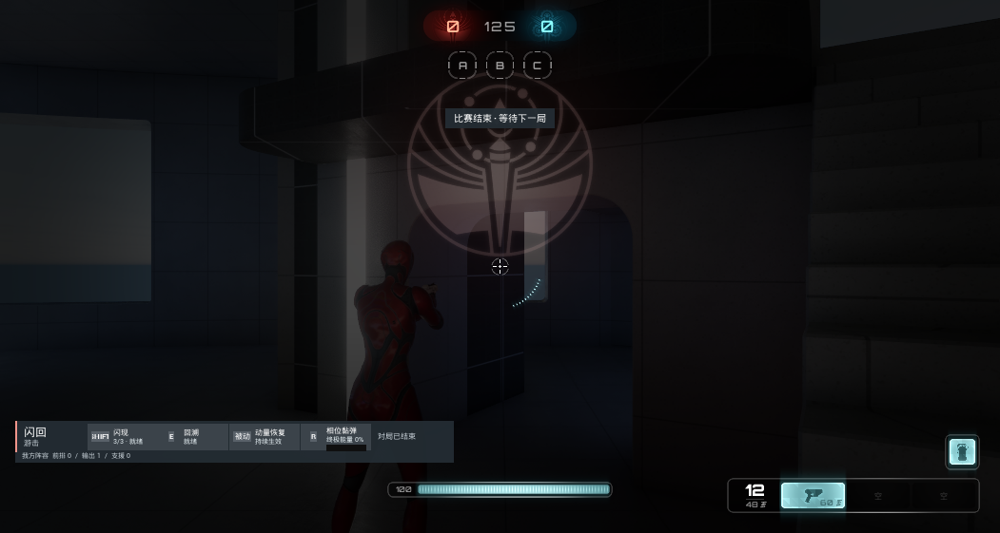
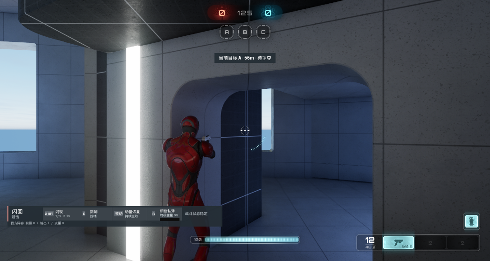

# 比赛结算与下一局衔接

原自有战术 HUD 仅读取控制点状态，结算后仍残留轮换倒计时。本次在轮换组件原有的 0.5 秒服务器定时更新中，扫描 GameState ASC 上的激活能力，读取 `ULyraGamePhaseAbility::GetGamePhaseTag()`；识别 `PostGame` 后停止轮换定时器，将 `bMatchEnded` 复制到客户端。HUD 优先显示“比赛结束 · 等待下一局”，清理占点提示、重生引导和技能失败提示。技能禁用与输入阻止逻辑保持原状。

后续流程由 Lyra 原生 `Phase_PostGame` 推进：等待结束后调用 `PlayNextGame`，通过 SeamlessTravel 重新加载地图；新世界实例重置结束标记。本次未改动原生计分、胜负规则与等待时间。实现面向地图重载，不包含同一世界内重复开始比赛的重置机制。

## 本次运行

UE 5.7.4 / CL 51494982，独立 Dedicated Server 与一个拥有客户端，非打包、同机 Loopback。两端各配置 150 ms 出站延迟与 2% 出站丢包；配置值不等于测得的 RTT。通过开发入口主动调用 `HandleVictory(1)`，在 0:0 时进入结算，检查后续自动切局。

- 旧世界进入 PostGame，服务器记录队伍 1 胜利；客户端收到结束标记并显示对应 HUD。终局阶段比分保持不变。
- 双端都生成新的世界实例，比分为 0:0，目标分为 125；服务器经过 Warmup 进入 Playing。
- 新局重新选择 Phase 后，两端均持有四项不重复的英雄来源 AbilitySpec，ASC Avatar 指向对应 Pawn。
- 同一新局 Pawn 释放闪现，双端充能 3→2、待确认数为 0，位置从 x=2008.96 到 x=2214.08，位移约 205 cm。
- 两个进程均正常退出，退出码为 0。

[脱敏双端采样、技能状态与日志指纹](data/round-transition.json)。`worldId` 只用于各进程内部前后比较，不能跨进程比较其数值。客户端阶段字段来自本地 PhaseMap，不能用其中的 `postGame=false` 否定服务器阶段；客户端结束状态以复制的 `objectiveEnded` 为准。

页面原有约 6 分 20 秒录像展示的是单机自然结算，保留原始内容及旧版赛后 HUD。当前截图展示此次更新。联网完整比赛、多人并发、公网、打包及断线重连不在本次验证范围内。

## 在合法宿主中复现

先按 [跨进程运行说明](跨进程网络案例.md) 构建、启动服务器及客户端，等待 Playing，选择 Phase 并配置网络模拟。启用开发驱动后，每个进程使用独立目录和递增命令编号。

1. 两端执行 `Console HeroArena.Debug.LogMatchFrame`，记录初始世界身份和比赛状态。
2. 仅在服务器执行 `FinishRound 1`。该入口只在非 Shipping、显式启用探针的 Dedicated Server 中可用，校验宿主 HandleVictory 函数的单个整型参数后调用原生胜利流程。
3. 持续采样两端 MatchFrame，等待服务器 PostGame 和客户端 `objectiveEnded=true`，使用客户端 `Shot` 保存提示。
4. 等待原生自动切局和 Warmup。确认双端世界身份变化、结束标记清零、目标分恢复、比分 0:0，并确认服务器 Playing。
5. 再次选择 Phase，读取两端 `LogGAS` 和 `LogBlinkNetwork next-round-before`。触发客户端 `Blink`，等待复制后采样 `next-round-blink`，对照充能、待确认请求、Avatar 和位置。
6. 正常退出两端。地图加载中不要因单次日志缺失立即退出；回执到达后，日志仍可能尚未刷新。

源码入口：[轮换组件](../Plugins/GameFeatures/HeroArena/Source/HeroArenaRuntime/Private/Components/HeroArenaControlPointRotationComponent.cpp)、[战术 HUD](../Plugins/GameFeatures/HeroArena/Source/HeroArenaRuntime/Private/UI/HeroArenaCombatHUDWidget.cpp)、[开发探针](../Plugins/GameFeatures/HeroArena/Source/HeroArenaRuntime/Private/HeroArenaNetworkProbe.cpp)。
