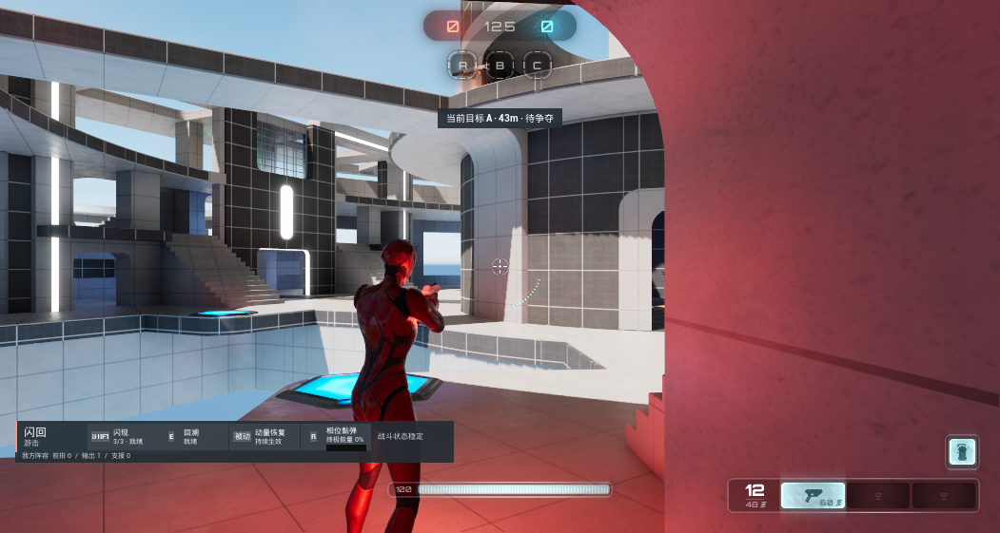

# 独立服务器：闪现预测、换人与重生

UE 5.7.4 / Lyra，同主机 Loopback UDP。一个 `UnrealEditor.exe -server -nullrhi` 作为 Dedicated Server，另一个 `UnrealEditor.exe -game -d3d12` 作为拥有客户端。两次独立运行分别使用普通网络，以及双端各 150 ms 出站延迟、2% 出站丢包；配置值不等于实测 RTT。

## 状态如何恢复

- **预测拒绝**：客户端经 Enhanced Input 发起 Blink，预测显示 2 格、待确认请求 1 个。开发入口仅在服务器阻止激活，GAS 返回拒绝后，客户端恢复 3 格、待确认清零，CMC 将角色拉回原位。服务器始终保留 3 格。
- **成功释放与补充**：解除阻止后，双端消耗至 2 格，位移约 205 cm；Capsule Sweep 因障碍缩短了最大 700 cm 的位移。同一 Pawn 随后恢复 3 格，排除了把重生重置当作补充成功的情况。
- **换人与重生**：切至 Striker 时两端有 7 项英雄来源 AbilitySpec，再切至 Phase 时为 4 项，无重复。通过 Lyra 自毁路径触发死亡，在约 9 秒后的采样中确认新 Pawn、ASC Avatar 绑定正确、Phase 4 项能力和满充能。9 秒是采样等待时间，不是测得的固定重生时长。



原始日志含机器目录和账号标识，保留在本地。公开阶段数据为 [弱网记录](data/separate-network.json) 与 [普通网络记录](data/separate-network-baseline.json)。数据同时保存世界时钟、服务器时钟估计和原始日志指纹，桌面截图只作为客户端运行画面，双端状态以对应记录核对。

## 实现边界

技能组件与预测键结算属于 HeroArena 扩展；基础角色、资产、GAS 网络激活、CMC 位移校正及重生流程复用 Lyra。本批增加开发专用跨进程驱动、时钟诊断与阶段比对，没有重写 GAS 或 CMC。

[HeroArenaNetworkProbe.cpp](../Plugins/GameFeatures/HeroArena/Source/HeroArenaRuntime/Private/HeroArenaNetworkProbe.cpp) 仅在非 Shipping 构建且传入 `-HeroArenaNetworkProbe=<run-role>` 时启用。驱动从 `Saved/PortfolioNetwork/<run-role>/` 读取编号命令，回执先写临时文件，再重命名。本地文件协调测试动作；技能请求和状态复制仍走 UE NetDriver。

开启驱动时，客户端忽略原生窗口输入并清除旧按键状态，测试技能由 Enhanced Input 注入。普通启动不注册此驱动。每次使用独立目录，避免重放旧命令。

## 在合法宿主中复现

先按 [宿主接入说明](接入与验证.md) 准备 Lyra 与本仓自有插件，构建 LyraEditor Development。下面参数中的工程路径按本机安装填写，不能直接运行缺少资源的公开快照。

服务器参数：

```text
LyraStarterGame.uproject /ShooterMaps/Maps/L_Convolution_Blockout?NumBots=0 -server -nullrhi -NoSound -port=17877 -MULTIHOME=127.0.0.1 -Experience=B_HeroArena_ControlPoints -HeroArenaNetworkProbe=case-server
```

日志出现 `listening on port 17877` 后启动客户端：

```text
LyraStarterGame.uproject 127.0.0.1:17877 -game -d3d12 -windowed -HeroArenaNetworkProbe=case-client
```

两个目录出现 `ready.txt` 后，继续等待服务器 `Playing Phase`，再等待场景预热。每个进程独立从 `0001.txt` 编号递增，将一条 UTF-8 命令写入临时文件后改名为编号文件；读取同编号 `.ack`，值为 `ok` 或 `rejected`。回执表示开发入口已处理，具体玩法结果还需读取状态日志。

测试顺序：

1. 服务器 `Console HeroArena.Debug.SetSelectionLocked 0`；客户端 `Console HeroArena.Debug.RequestHero Phase`、`Continue`。等待复制完成。
2. 两端 `Place 2008.96 136.24 140.17 0`。服务器设置 Pawn 起点，客户端只设置控制朝向。设置完成后不再调整位置。
3. 两端 `Console HeroArena.Debug.SetNetworkSimulation 150 2`；普通对照使用 `0 0`。
4. 服务器 `Console HeroArena.Debug.SetBlinkBlocked 0 1`；客户端 `Blink`。读取早期客户端状态，等待 1.5 秒后读取双端状态。
5. 服务器 `Console HeroArena.Debug.SetBlinkBlocked 0 0`；客户端 `Blink`。等待 1.5 秒后读取双端状态，再等待 4.5 秒核对补充。
6. 客户端依次请求 Striker、Phase，每次等待并读取双端 GAS 状态。服务器 `Eliminate` 触发标准自毁；等待约 9 秒核对新 Pawn 和 Avatar。
7. 客户端 `Continue`、`Shot` 获取画面。先向客户端写 `Quit`，再向服务器写 `Quit`，确认两个进程退出。

状态命令为 `Console HeroArena.Debug.LogBlinkNetwork <stage>` 和 `Console HeroArena.Debug.LogGAS`。第一条也记录当前世界时间与 GameState 估计的服务器时间。阶段采样有先后顺序，不声称帧同步。

## 排查与当前范围

早期测试在 Warmup 结束前设置起点，后续 Pawn 替换导致位置失效；自伤调试指令禁止同源目标，不能触发期望死亡。最终改为等待正常阶段转换，并走 Lyra 标准自毁。快速轮询还暴露了回执文件写入锁问题，已改为写完临时文件后重命名。

首次冷启动时，客户端曾显示 7.54 秒剩余时间，高于 4 秒补充周期。补充时钟记录并完成预热后，该批弱网成功阶段的顺序采样为服务器 2.64 秒、客户端 2.61 秒。后续已将显示改为服务器快照加本地递减，见 [充能倒计时修正与故障注入](闪现充能倒计时.md)。引擎全局时钟算法保持原状。运行还出现宿主 GeneratedMeshColdStorage 的既有蓝图编译告警，未在本批修复。

当前覆盖非打包、同机独立进程和单拥有客户端。[完整比赛与自然切局](完整联网比赛.md) 已另行记录；多玩家并发、公网、重连与长期运行仍需后续验证。原双视角视频继续保留同进程双 PIE 标签。
